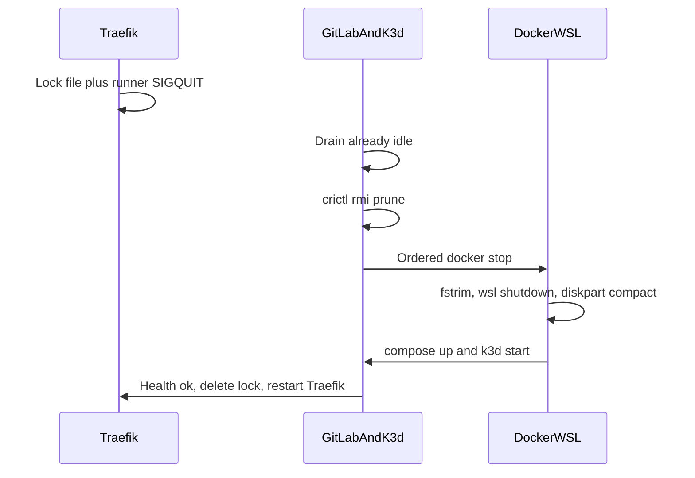

# Disk cleanup and VHDX compact — 13 October 2026

← [Ongoing operations](../04_operations.md)

Record of a maintenance window on the Windows Docker Desktop host (`MSAMS-WSC`, Docker Engine 29.8.1). The goal was to delete unused k3d images, return that space to `C:`, and keep GitLab, databases, registry blobs, and Kubernetes volumes intact.

Public traffic was closed before anything was stopped, and reopened only after health checks. The window ran about 08:28–10:13 UTC+7.

## Result

| | Bytes | GiB |
|---|---:|---:|
| `docker_data.vhdx` before compact | 774,997,278,720 | 721.8 |
| After compact | 208,621,535,232 | 194.3 |
| After workloads pulled missing images back | 208,655,089,664 | 194.3 |
| Returned to `C:` | 566,342,189,056 | 527.4 |

`C:` free space after the window was about 605 GiB. Path:

`%LOCALAPPDATA%\Docker\wsl\disk\docker_data.vhdx`

The file is a dynamic VHDX and is **not** an NTFS sparse file. Deleting data inside Docker does not shrink it. `fstrim` inside the guest, then an offline compact, is what returned the space.

## What was left in place

- Named volumes and bind mounts, including `.vols/`, GitLab git data, and the GitLab Container Registry blobs.
- The k3d / k3s volume. Unused images were removed with `crictl rmi --prune` only. `crictl rmi --all` and hand-deletion of overlay snapshots were not used.
- Watchdog trip state. The Traefik lock from `bootstrap/watchdog.sh` was reused. `.vols/watchdog.state` was not written, and the watchdog was not run with `--force`.
- Containers that were already stopped and were not part of this stack: `qestor-db`, `transcriptor-ollama`, `transcriptor-worker`, `authz-hasura`, `authz-pg`, old runner job containers.

## Why the VHDX was the problem

The previous prune (30 September 2026) had already freed space **inside** the Docker filesystem, but the VHDX file on `C:` stayed about 722 GiB. Two weeks of redeploys filled k3d containerd again.

Immediately before this prune, the Docker filesystem (`/mnt/docker-desktop-disk`, about 1007 GiB) held the accumulated k3d images and snapshots. Host `docker image prune` does not see that containerd store. The reclaim that is safe while the node is up is:

```bash
docker exec k3d-dsoaas-server-0 crictl rmi --prune
```

That deletes images not referenced by a running container and lets containerd drop their snapshots. It does not touch pod volumes, etcd, or the GitLab registry.

## Sequence



### 1. Cut traffic

The lock file from `install_traefik_lock` in `bootstrap/watchdog.sh` was written to `/etc/traefik/dynamic/zz-watchdog-lock.yml` inside the Traefik container (274 bytes). It is a catch-all router on `websecure`, priority `1000000`, with a dead backend `http://127.0.0.1:9`.

`docker kill -s QUIT gitlab-runner` was sent so the runner would finish any current job and accept no new ones.

Public checks of `gitlab.devops.yadatechnology.com` and `console.devops.yadatechnology.com` returned **HTTP 502**. That is the expected result of this lock. Traefik reaches the dead backend and answers 502, not 503. 502 here means traffic is blocked.

The file lives in the container writable layer. Traefik’s entrypoint copies templates in and does not delete extra files, so a normal stop/start keeps the lock. A later `docker compose up` **recreated** Traefik and dropped the file. It was written again before health checks finished. See [Restore](#6-restore).

### 2. Drain

Same conditions as `drain()` in `bootstrap/watchdog.sh`: zero running `runner-*` containers, and zero `git-receive-pack` / `git-upload-pack` processes inside `gitlab`.

Both counts were already 0, so the window did not wait. The abort rule was: if drain had still been busy at the timeout (default 3600s, poll 20s), compact would not have run.

### 3. k3d prune

While `k3d-dsoaas-server-0` was still running:

| | Before | After |
|---|---:|---:|
| Images | 753 | 47 |
| Filesystem used | 445 GiB (47%) | 157 GiB (17%) |
| Pods | 52 Running | 52 Running |

`crictl rmi --prune` exited 0. The log tail included `DeadlineExceeded` lines, which this prune often prints after the unused images are already gone. A second pass was not required. `kubectl get pods -A` had no non-Running pods before shutdown.

### 4. Ordered stop

Stop timeouts match the watchdog defaults (`compose stop -t`, then `docker stop -t` for anything outside the compose files). Every stop returned success. `docker ps -q` was empty before compact. Nothing was removed with `docker rm`.

| Order | Timeout | What stopped |
|---|---:|---|
| 1 | 180s | `gitlab-runner` (already exiting after SIGQUIT) |
| 2 | 900s | `gitlab` |
| 3 | 180s | `api`, `console`, `sonarqube`, then `sonarqube-mcp` |
| 4 | 180s | `minio` |
| 5 | 600s | `mongo`, `postgres` |
| 6 | 180s | `vault`, `keycloak`, `oauth2-proxy`, `oauth2-proxy-apps`, `oauth2-proxy-devtools`, `oauth2-proxy-apps-hostfix` |
| 7 | 180s | devtools compose (`devtools/docker-compose.yml`) |
| 8 | 120s | `mcserver`, `transcriptor-web-1`, `transcriptor-valkey-1` |
| 9 | 180s | `k3d-dsoaas-server-0`, `k3d-dsoaas-serverlb` |
| 10 | 120s | `wireguard`, `traefik` |

The lock file was still in Traefik’s writable layer at this point, so the first moments after a normal restart would have stayed closed. Traefik was later recreated; see below.

`cloudflared` was not running. `devtools-rabbitmq` had already been stopped for weeks; the devtools compose stop still included it because it is a service in that file.

### 5. Compact

`Optimize-VHD` is the command in [04_operations.md](../04_operations.md). It was **not** used.

The shell was already elevated (`is_admin=True`), but `Get-Command Optimize-VHD` was empty. `Microsoft-Hyper-V-Management-PowerShell` is Disabled. Enabling it without parents failed (DISM error 50): the parent features are `Microsoft-Hyper-V-Tools-All` and `Microsoft-Hyper-V-All`. Enabling the full Hyper-V role can require a reboot, so it was not enabled.

Compact path that actually ran:

1. `fstrim -av` inside `wsl -d docker-desktop` as root, while containers were stopped and the VM was still up. `/mnt/docker-desktop-disk` (`/dev/sdd`, ext4, 154.4 GiB used of 1006.9 GiB) reported **843.7 GiB trimmed**. The root filesystem trimmed 48 MiB.
2. `DockerCli.exe -Shutdown`, then `wsl --shutdown`. Both `docker-desktop` and `Ubuntu-20.04` were Stopped. No `docker`, `vmwp`, or `vmmem` process remained.
3. `diskpart` against the offline VHDX:

```text
select vdisk file="C:\Users\MSAMS\AppData\Local\Docker\wsl\disk\docker_data.vhdx"
attach vdisk readonly
compact vdisk
detach vdisk
```

DiskPart selected, attached, compacted, and detached the file. Exit code 0. Runtime about 58 minutes (09:05–10:04 UTC+7). The file length stayed 722 GiB until the compact finished, then dropped to 194.3 GiB. `C:` free space dipped by roughly 15 GiB during the compact and then rose to about 606 GiB.

`fstrim` matters on this host. Without it, compact only punches blocks the guest has already discarded, and the VHDX stays large even when the filesystem looks empty.

### 6. Restore

Docker Desktop was started. `docker info` succeeded immediately (Engine 29.8.1, 0 containers running, 52 present).

`docker compose up -d` **recreated** platform containers instead of only starting the stopped ones. Compose warned that `dsoaas-postgres-data`, `dsoaas-mongo-data`, and `dsoaas-sonarqube-data` already existed and were not created by Compose. Those volumes were reused. Bind mounts under `.vols/` were not replaced.

Recreating Traefik discarded `zz-watchdog-lock.yml`. The same lock YAML was written back into the new container (274 bytes) before the rest of the health checks.

`docker compose up -d` then exited 1 because `vault-oidc-init` exited 2. That one-shot configures OpenBao OIDC against `https://sso.yadatechnology.com/realms/devops`. The lock made that URL return 502, so the discovery check failed. Vault itself was already unsealed and healthy, and the OIDC auth method was already enabled. The failed write did not complete.

Because `api` depends on `vault-oidc-init` completing successfully, these were started with `--no-deps` while the lock was still up:

- `sonarqube` (its own init containers had already exited 0)
- `api`, then `console` after the API was healthy
- `oauth2-proxy-devtools`
- `sonarqube-init` (exited 0; bootstrap marker path)

Also started, because they had been running before the stop and `unless-stopped` does not bring them back after an explicit `docker stop`:

- `k3d-dsoaas-server-0`, `k3d-dsoaas-serverlb`
- `sonarqube-mcp` (compose profile `sonarmcp`)
- devtools compose
- `mcserver`, `transcriptor-web-1`, `transcriptor-valkey-1`, `wireguard`

`oauth2-proxy-apps-hostfix` crash-looped until k3d was up. nginx resolves `k3d-dsoaas-server-0` at start. After the k3d containers were running, hostfix stayed up.

#### Health before the lock was removed

| Check | Result |
|---|---|
| `gitlab`, `postgres`, `mongo`, `vault`, `keycloak`, `sonarqube`, `api`, `console`, `traefik` | healthy |
| Postgres databases | `cfa2_dev`, `gitlabhq_production`, `keycloak`, `openbao`, `postgres`, `registry`, `sonar` |
| Mongo `ping` on `admin` | ok |
| `bootstrap/gitaly-promote-incoming.sh` | `dirs=0 moved=0 dup_removed=0 leftover=0` |
| k3d node | `Ready`, no taints |
| devtools Grafana, Loki, MinIO, MySQL, Postgres, RabbitMQ | up; data services healthy |

#### Opening traffic

`/etc/traefik/dynamic/zz-watchdog-lock.yml` was deleted and Traefik was restarted. The file was still absent after the restart.

| URL | Status |
|---|---|
| `https://gitlab.devops.yadatechnology.com/users/sign_in` | 200 |
| `https://console.devops.yadatechnology.com/` | 302 (sign-in redirect) |
| `https://registry.devops.yadatechnology.com/v2/` | 401 with `Docker-Distribution-Api-Version: registry/2.0` |

401 on `/v2/` is a live registry asking for a token. 502 would have meant the lock was still in front.

`vault-oidc-init` was recreated with `--no-deps` after SSO was reachable. It exited 0.

#### Pods that had to pull again

After k3d came back, 31 pods were Running and 21 were `ErrImagePull` / `ImagePullBackOff`. The missing image digests were not in containerd (47 images, the same count as right after the prune). Those pods had not been holding a container reference at prune time, so `crictl rmi --prune` was allowed to delete the images. While the lock was up, kubelet’s HEAD to `registry.devops.yadatechnology.com` returned 502, so they could not pull.

The 21 Pending pods were deleted so the deployments would recreate them against the open registry. Shortly after that, `kubectl get pods -A` showed **52 Running** and no other phases.

Those pulls wrote about 34 MB back onto the VHDX (`208,655,089,664` bytes). A later deploy wave will grow it again. Space on `C:` does not come back until the next offline compact.

## Still failing after the window

**`mcserver`.** The container starts, then the image helper exits 1:

`Project came back that wasn't expected: ore-veines-plus`

That is the Modrinth lookup in the itzg Minecraft entrypoint (`mc-image-helper` 1.70.0), which runs on every start. The world bind mount was not deleted. The server was up before this window and is crash-looping after the start. It needs a mod-list or Modrinth-side fix, separate from disk reclaim.

**`devtools-rabbitmq-init`.** Exited 7 while logging `PUT vhost dev`. `devtools-rabbitmq` itself is healthy. RabbitMQ had been stopped for about seven weeks. This `docker compose up -d` started it because it is a service in `devtools/docker-compose.yml`.

One-shot init containers (`postgres-*-init`, `mongo-init`, `minio-init`, `sonarqube-*-init`, `vault-prod-bootstrap`, `vault-oidc-init`) exited 0, which is their normal end state.

## Repeat notes

Do this only with the same gates. Abort the compact if drain does not finish or if `gitlab`, `postgres`, `mongo`, or `k3d` fails to stop. Do not compact while `docker ps -q` is non-empty.

1. Install the Traefik lock and SIGQUIT the runner. Treat HTTP 502 from the dead backend as “blocked”.
2. Wait until runner job containers and git pack processes are both zero.
3. `crictl rmi --prune` on `k3d-dsoaas-server-0`. Confirm pods still Running. Expect some `DeadlineExceeded` lines.
4. Stop in the order in the table above. Leave the lock file in place.
5. `fstrim` the Docker data disk (`/mnt/docker-desktop-disk` in the `docker-desktop` WSL distro) **before** shutting WSL down.
6. Quit Docker Desktop, then `wsl --shutdown`.
7. Compact the offline VHDX. On this host use `diskpart` `attach vdisk readonly` / `compact vdisk` / `detach vdisk`, unless `Optimize-VHD` is actually installed. Do not enable the full Hyper-V role just to get the cmdlet.
8. Start Docker, `docker compose up -d`, devtools compose, and any non-compose containers that were running (`k3d`, `sonarqube-mcp`, WireGuard, side projects).
9. If Compose recreates Traefik, write the lock file again before calling the window done.
10. If `vault-oidc-init` fails on the public SSO URL, that is the lock. Leave Vault up, start `api` / `console` with `--no-deps`, and rerun the init after the lock is gone.
11. Run `bootstrap/gitaly-promote-incoming.sh`.
12. Delete the lock and restart Traefik. Confirm a public host is not 502/503, `/v2/` is 401, and pods are Running. Pods whose images were pruned will pull from the registry only after this step.

Host images, GitLab registry retention, and Mongo journal cleanup are separate procedures in [04_operations.md](../04_operations.md). They were not part of this window.
