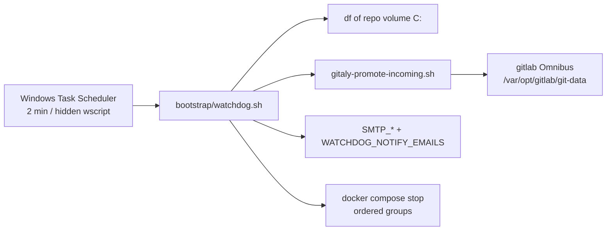
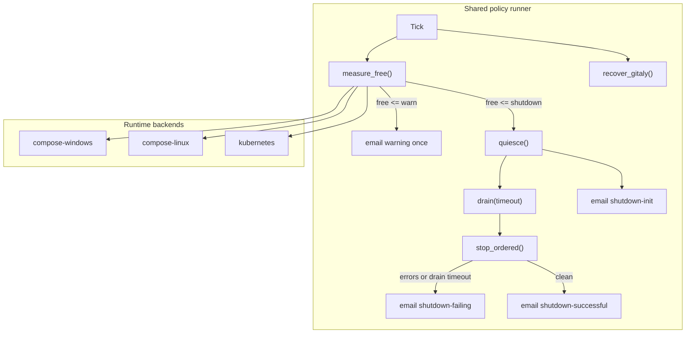

# Milestone — Host failsafe policy and deployment backends

← [Back to Milestone designs](index.md)

> **Status**: Proposed (Compose-host backend **partially shipped**; Linux/k8s/cloud backends not started)
> **Audience**: Platform maintainers, future-Phase planners
> **Depends on**: [Deployment models](04_deployment_models.md) for Kubernetes-mode topology; Compose-host work does not wait on `dsoctl`
> **Cross-references**: [Day-to-day operations — disk watchdog](../01_infra/04_operations.md#disk-watchdog-failsafe), [Env — disk watchdog](../01_infra/02_env.md#disk-watchdog), [Architecture](../99_maintainers/01_architecture.md)

The control plane is meant to be platform-agnostic. The disk/ENOMEM failures of August 2026 (Gitaly quarantine leaving default branches as missing objects, artifact upload 500s, stuck MRs) were host-and-runtime specific. This milestone captures a **single failsafe policy** (warn → block new work → drain → ordered stop → SMTP) and **pluggable backends** so Linux Compose, Kubernetes, and cloud disks get the same operator-facing behaviour without reusing the Windows Task Scheduler script as if it were portable.

---

## Table of contents

1. [Problem & motivation](#1-problem--motivation)
2. [Current state — what's wired up today](#2-current-state--whats-wired-up-today)
3. [Goal & non-goals](#3-goal--non-goals)
4. [Architecture](#4-architecture)
5. [Config & events](#5-config--events)
6. [Operational considerations](#6-operational-considerations)
7. [Migration & adoption story](#7-migration--adoption-story)
8. [Open questions](#8-open-questions)
9. [Implementation outline](#9-implementation-outline)
10. [Risks & rollback](#10-risks--rollback)
11. [Appendix](#11-appendix)

---

## 1. Problem & motivation

When the Windows Compose host filled the NTFS volume (registry + Mongo WiredTiger journal leak on a bind mount) and GitLab hit `cannot allocate memory`, Gitaly left push objects in `objects/tmp_objdir-incoming-*`. Refs (including `datahub-fe` `development`) pointed at SHAs that were not in the object store. The GitLab UI returned 500 on branch list; MRs stayed in `preparing`. CI failed on artifact upload 500 and Kaniko layer extract errors. That is data corruption and operator-visible outage, not “disk is a bit full.”

A hard `docker compose stop` _during_ `git-receive-pack` recreates the same quarantine hole. The failsafe must **stop accepting new writes**, **wait**, then stop — and it must watch the filesystem that actually holds GitLab data.

Those mechanics differ by runtime:

- Windows Compose: `C:` bind mounts vs Docker VHDX named volumes are two disks.
- Linux Compose: one or more ext4/xfs mounts; cron, not Task Scheduler.
- Kubernetes / cloud: PVC `kubelet` disk pressure, Prometheus, Helm/GitLab chart, node drain — not `compose stop`.

Without this milestone, the next install (Linux VM or GKE) will copy the Windows script, measure the wrong disk, and either never trip or kill the wrong thing.

---

## 2. Current state — what's wired up today

| Layer                  | Current behaviour                                                                                             | Gap                                                          |
| ---------------------- | ------------------------------------------------------------------------------------------------------------- | ------------------------------------------------------------ |
| Policy                 | Two GiB thresholds + four email events in `.env`                                                              | Not named as a portable contract; mixed with Windows paths   |
| Compose-host (Windows) | `watchdog.sh` + `watchdog.cmd` + `watchdog-hidden.vbs`; Traefik 503 lock; SIGQUIT runner; drain; ordered stop | Does not measure Docker VHDX free space                      |
| Compose-host (Linux)   | Same bash script _can_ run under cron                                                                         | No packaged unit/cron, untested                              |
| Gitaly recover         | Promote leftover `tmp_objdir-incoming-*` via `docker exec`                                                    | Omnibus-only path; not a chart/Praefect job                  |
| Kubernetes / cloud     | Nothing                                                                                                       | No PVC alerts, no scale-down, no Alertmanager route          |
| Mongo WT               | Named volume + `mongo/mongod.conf` archive/checkpoint                                                         | Document “never bind NTFS”; k8s PVC not written              |
| Registry retention     | GitLab API `keep_n` / `older_than`                                                                            | Already portable; keep as a _reclaim_ tool, not the failsafe |

Shipped Compose-host pieces live in `bootstrap/watchdog.sh`, `bootstrap/gitaly-promote-incoming.sh`, `bootstrap/lib/send-smtp.sh`, and `__DOCS__/01_infra/04_operations.md`.

---

## 3. Goal & non-goals

### 3.1 Goals

1. **One policy document** — warn GiB, shutdown GiB, drain/stop timeouts, SMTP event names — identical in meaning on every backend.
2. **Backend interface** — `measure_free`, `quiesce`, `drain`, `stop_ordered`, `recover_gitaly` implemented per runtime; policy runner is shared.
3. **Compose-Linux** — systemd timer or cron wrapping the same bash policy; `df` on the data mount(s); no VBS.
4. **Kubernetes** — watch PVC / node ephemeral-storage; quiesce via GitLab chart + runner `concurrency=0` / Job drain; do **not** delete the cluster; SMTP via the same events.
5. **Two disks where they exist** — NTFS (or host bind) **and** Docker/VHDX or each PVC; trip if _either_ is below threshold.
6. **Gitaly recover** remains a first-class tick on Omnibus; chart backend uses the GitLab-documented equivalent.

### 3.2 Non-goals

- **Auto-start after shutdown** — operator `watchdog --clear` + compose/helm up. Unchanged.
- **Replacing Prometheus/Cloud Monitoring** — k8s backend may _emit_ to them; it does not invent a second metrics stack if the cluster already has one.
- **Autoscaling cloud disks as the only defence** — grow-disk is complementary; quarantine still happens if memory dies first.
- **Rewriting Git refs** — promote objects only; never move `development` to another SHA automatically.
- **Shipping a full `dsoaas-platform` Helm chart** — that is milestone 04. This milestone only specifies failsafe hooks that chart must expose.

---

## 4. Architecture

### 4.1 High-level design

**compose-windows** (shipped): `df` on repo root; Task Scheduler + hidden wscript; `docker compose stop`; Traefik file 503; `docker exec gitlab` promote.

**compose-linux**: same script; systemd `OnUnitActiveSec=120`; measure `/var/lib/docker` and the bind-mount path separately.

**kubernetes**: CronJob or controller; `kubelet` / PVC usage (metrics-server or `df` in a privileged debug pod is a last resort); quiesce = set GitLab `nginx`/webservice unavailable + scale runner to 0; drain = wait for Runner `builds` + no `receive-pack` pods; stop = scale GitLab/MinIO/Mongo StatefulSets to 0, **leave** ingress/coredns/etcd up unless the operator opts into `WATCHDOG_STOP_CLUSTER=1` (default off).

### 4.2 What changes vs. what stays

| Layer / component               | Before                    | After                             | Change type         |
| ------------------------------- | ------------------------- | --------------------------------- | ------------------- |
| Policy + SMTP events            | Embedded in `watchdog.sh` | Shared module + backend shims     | Modified            |
| Windows host                    | Works                     | Remains default backend           | Unchanged behaviour |
| Linux Compose                   | Manual cron               | Documented unit + install snippet | New                 |
| k8s / cloud                     | Absent                    | Backend + runbook                 | New                 |
| Gitaly promote                  | Omnibus docker exec       | Plus chart Job if GitLab is Helm  | New                 |
| Registry retention / mongo conf | Existing                  | Cited as reclaim, not failsafe    | Unchanged           |

---

## 5. Config & events

No GraphQL/schema change. Config stays env (Compose) / values (Helm), same names:

| Variable                                      | Meaning                                               |
| --------------------------------------------- | ----------------------------------------------------- |
| `WATCHDOG_WARN_FREE_GB`                       | Warning email once per excursion                      |
| `WATCHDOG_SHUTDOWN_FREE_GB`                   | Start quiesce → drain → stop                          |
| `WATCHDOG_NOTIFY_EMAILS`                      | Comma-separated To:                                   |
| `WATCHDOG_DRAIN_SECONDS`                      | Max wait for in-flight work (default relaxed, ≥ 3600) |
| `WATCHDOG_GITLAB_STOP_TIMEOUT`                | GitLab process SIGTERM wait                           |
| `WATCHDOG_STOP_TIMEOUT` / `_DATA_` / `_EDGE_` | Other stop groups                                     |
| `SMTP_*`                                      | Shared sender (GitLab/Keycloak/watchdog)              |

Events (must stay stable for filters): `warning`, `shutdown-init`, `shutdown-failing`, `shutdown-successful`.

Helm (milestone 04) should expose the same keys under `failsafe:` and select `backend: compose | kubernetes`.

---

## 6. Operational considerations

- **Wrong disk** is the main false-negative. Windows must eventually measure VHDX as well as `C:`. Linux must measure the GitLab bind _and_ Docker data-root. k8s must measure the GitLab PVC, not the API server node.
- **Mid-push stop** is the main false-positive damage. Drain timeouts send `shutdown-failing` even if processes exited.
- SMTP failure must not abort shutdown (already true on Compose-host).
- Hidden Windows launcher must stay; Linux must not depend on it.
- DevTools is a second Compose file — out of scope unless `WATCHDOG_INCLUDE_DEVTOOLS=1`.

---

## 7. Migration & adoption story

### 7.1 Backward compatibility

Existing Windows Task Scheduler install keeps working. Env var names stay. `WATCHDOG_MIN_FREE_GB` remains an alias for shutdown if the new name is unset.

### 7.2 Opt-in / rollout

1. Compose-Windows: already optional via Task Scheduler (not part of `make bootstrap`).
2. Compose-Linux: add `bootstrap/watchdog.service` + `.timer`; operator copies and `systemctl enable --now`.
3. Kubernetes: after milestone 04 chart exists, enable `failsafe.enabled=true` in values.

### 7.3 Existing hosts

No forced migration. Document “if you cloned the Windows VBS onto Linux, replace it with the timer.”

---

## 8. Open questions

### Q1 — k8s: stop GitLab only vs scale the whole platform namespace

**Option A**: Scale only GitLab + runner + registry-adjacent (MinIO). Keycloak/Vault stay up.

**Option B**: Scale the entire platform namespace to 0 (mirrors Compose ordered stop).

**Recommended**: A as default (`WATCHDOG_SCOPE=gitlab-writes`). B as opt-in. Killing Vault mid-ticket is worse than a full disk on GitLab.

### Q2 — how to measure PVC usage without a custom exporter

**Option A**: Prometheus `kubelet_volume_stats_available_bytes` (cluster must have metrics).

**Option B**: Sidecar `df` on the GitLab volume.

**Recommended**: A when metrics exist; B as fallback CronJob.

### Q3 — VHDX free space on Windows

**Option A**: Defer; only `C:` (today).

**Option B**: Parse Docker Desktop / `wsl -d docker-desktop -- df`.

**Recommended**: B in this milestone’s Compose-Windows track — the named-volume disk can fill while `C:` still shows hundreds of GiB.

---

## 9. Implementation outline

### Track A — Policy extraction (Compose)

- [ ] Split `watchdog.sh` into policy + `backends/compose.sh` (Windows/Linux share compose stop)
- [ ] Measure **two** sources on Windows: repo `df` and Docker data-root / VHDX (Q3)
- [ ] Keep SMTP events and relaxed timeout defaults
- [ ] Tests: dry-run tick; warn hysteresis; do not send shutdown when only warn trips

### Track B — Compose-Linux

- [ ] `bootstrap/systemd/dsoaas-watchdog.service` + `.timer` (120s)
- [ ] Install notes in `04_operations.md`
- [ ] Smoke on a Linux VM: trip warn with a fake `df` hook

### Track C — Kubernetes backend (after or with milestone 04)

- [ ] `failsafe` values + CronJob/controller
- [ ] `quiesce` / `drain` / `stop` using scale + wait for runner pods
- [ ] Default scope GitLab-writes only (Q1-A)
- [ ] Gitaly recover Job for chart layout (or document “Omnibus-in-StatefulSet still uses promote script”)

### Track D — Documentation

- [x] Compose-host runbook in `01_infra/04_operations.md` (partial)
- [ ] This milestone: status updates as tracks land
- [ ] Cross-link from `04_deployment_models.md` operator UX (failsafe is mode-specific mechanism, same policy)
- [ ] `99_maintainers/02_services.md` one-liner: failsafe is host/backend, not a Compose service

---

## 10. Risks & rollback

| Risk                                  | Likelihood         | Impact                       | Mitigation                          | Rollback             |
| ------------------------------------- | ------------------ | ---------------------------- | ----------------------------------- | -------------------- |
| Trip on the wrong filesystem          | High if we skip Q3 | High (no trip or false trip) | Dual measure; document which `df`   | Disable timer/task   |
| Drain timeout still cuts receive-pack | Medium             | High (quarantine)            | Long default drain; promote tick    | Promote script       |
| k8s backend scales etcd/ingress       | Low if Q1-A        | Critical                     | Default scope gitlab-writes         | `kubectl scale` back |
| SMTP outage hides warning             | Medium             | Medium                       | Log + optional second channel later | N/A                  |

**Master rollback**: disable the scheduler/CronJob; policy scripts are optional and not on the `make bootstrap` path.

---

## 11. Appendix

### 11.1 Decision log

| Question              | Choice                                  | Date       | Rationale                                                |
| --------------------- | --------------------------------------- | ---------- | -------------------------------------------------------- |
| Drain vs hard stop    | Drain then ordered stop                 | 2026-08-11 | Hard stop mid-push caused missing default-branch objects |
| Two thresholds + SMTP | Warn + shutdown; four events            | 2026-08-11 | Operators need time to reclaim before stop               |
| Timeouts              | Relaxed defaults (1h drain, 15m GitLab) | 2026-08-11 | Safety over haste                                        |
| Q1 k8s scope          | _pending_ (recommend A)                 | —          | —                                                        |
| Q2 PVC measure        | _pending_ (recommend A then B)          | —          | —                                                        |
| Q3 VHDX               | _pending_ (recommend B)                 | —          | —                                                        |

### 11.2 Cross-references

- `bootstrap/watchdog.sh`, `bootstrap/watchdog.cmd`, `bootstrap/watchdog-hidden.vbs`
- `bootstrap/gitaly-promote-incoming.sh`, `bootstrap/lib/send-smtp.sh`
- `__DOCS__/01_infra/04_operations.md`, `__DOCS__/01_infra/02_env.md`
- [04 — Deployment models](04_deployment_models.md)

---

_Authored: 2026-08-11 · Status: Proposed (Compose-host partial) · See [milestone index](index.md)._
