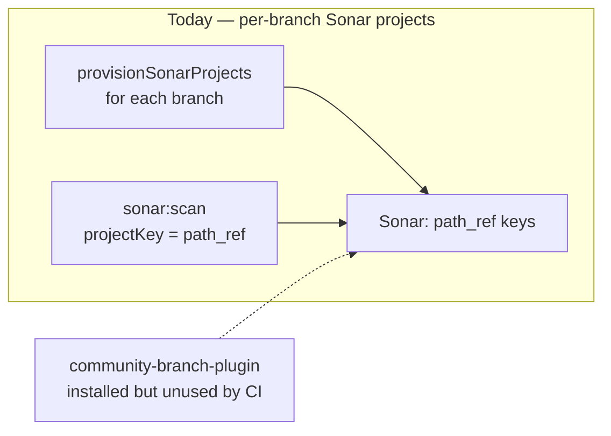
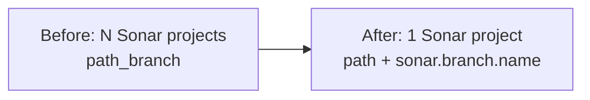
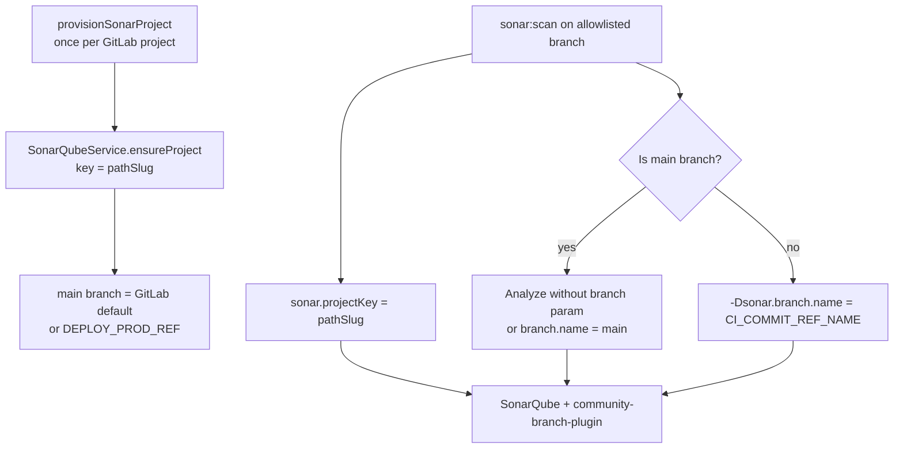

# Milestone — Sonar Native Branch Analysis

← [Back to Milestone designs](index.md)

> **Status**: Proposed (not yet scheduled)
> **Audience**: Platform maintainers, future-Phase planners
> **Cross-references**: [CI/CD — SonarQube](../99_maintainers/06_ci_cd.md#sonarqube), [Services — sonarqube](../99_maintainers/02_services.md#sonarqube), [Manual onboarding — Sonar](../03_devs/06_manual_onboarding.md#sonarqube-opt-in), [SonarQube SSO](../02_admin/09_sonarqube_sso.md)

The stack already runs SonarQube Community with the **community branch plugin** (`mc1arke/sonarqube-with-community-branch-plugin` plus javaagent hooks in Compose). Provisioning and CI, however, still implement the old Community workaround: **one Sonar analysis project per Git branch** (`{path}_{ref}`). This milestone retires that workaround and aligns Management API, shared pipeline, console, and docs with **one Sonar project per GitLab project** and native branch analysis (`sonar.branch.name`).

---

## Table of contents

1. [Problem & motivation](#1-problem--motivation)
2. [Current state — what's wired up today](#2-current-state--whats-wired-up-today)
3. [Goal & non-goals](#3-goal--non-goals)
4. [Architecture](#4-architecture)
5. [API, schema & config changes](#5-api-schema--config-changes)
6. [Operational considerations](#6-operational-considerations)
7. [Migration & adoption story](#7-migration--adoption-story)
8. [Open questions](#8-open-questions)
9. [Implementation outline](#9-implementation-outline)
10. [Risks & rollback](#10-risks--rollback)
11. [Appendix](#11-appendix)

---

## 1. Problem & motivation

Vanilla SonarQube Community Build does not support branch or PR analysis. The platform worked around that by treating each Git branch as a **separate Sonar project**:

- Keys look like `clients-demo-monorepo-fe_develop`, `…_staging`, `…_main`.
- `provisionSonarProjects` creates N Sonar projects for N allowlisted branches.
- `sonar:scan` always sets `sonar.projectKey` to `{CI_PROJECT_PATH_SLUG}_{CI_COMMIT_REF_SLUG}`.

That workaround has real costs now that branch analysis is available on the stack:

- **UI clutter** — operators see three (or more) Sonar “projects” for one GitLab repo; quality history is fragmented.
- **False mental model** — “provision Sonar for branches” sounds like branch analysis but is actually project fan-out.
- **Operational drag** — enabling a new branch means another Sonar project create; deleting a branch leave orphans unless `deleteSonarProjects` is called.
- **Wasted plugin capability** — the community branch plugin is already installed and agent-attached; CI never passes `sonar.branch.name`, so branches never appear under one project.

Leaving the workaround in place after adopting the plugin doubles the maintenance surface (two models in docs, console, and key builders) without a benefit.

---

## 2. Current state — what's wired up today



| Layer                                | Current behaviour                                                                     | Gap                                                   |
| ------------------------------------ | ------------------------------------------------------------------------------------- | ----------------------------------------------------- |
| Compose Sonar image                  | `mc1arke/sonarqube-with-community-branch-plugin`; javaagent on web/CE                 | Plugin ready; provisioning model not updated          |
| `buildSonarProjectKey(path, branch)` | Always appends ref slug                                                               | No path-only key helper as primary                    |
| `SonarQubeService.ensureProject`     | Creates one key per call; `main` param = Git branch label                             | Used N times per GitLab project                       |
| `provisionSonarProjects`             | Loops branches → N projects; merges allowlist                                         | Couples allowlist to project fan-out                  |
| `sonar:scan`                         | `PROJECT_KEY="${CI_PROJECT_PATH_SLUG}_${CI_COMMIT_REF_SLUG}"`; no `sonar.branch.name` | Cannot use native branch views / new-code on branches |
| Console `SonarPanel`                 | “Provision branches” table of per-branch dashboard URLs                               | UX encodes the workaround                             |
| Maintainer docs                      | Explicitly: “one Sonar project per branch (Community Build)”                          | Docs lag the plugin reality                           |

Relevant code:

- [`api/src/projects/sonar/sonar-project-key.util.ts`](../../api/src/projects/sonar/sonar-project-key.util.ts)
- [`api/src/projects/projects.service.ts`](../../api/src/projects/projects.service.ts) (`provisionSonarProjects` / `deleteSonarProjects`)
- [`api/src/sonarqube/sonarqube.service.ts`](../../api/src/sonarqube/sonarqube.service.ts)
- [`configs/auto-devops-pipeline/.gitlab-ci.yml`](../../configs/auto-devops-pipeline/.gitlab-ci.yml) (`.sonar-scan`)
- [`console/src/components/SonarPanel.tsx`](../../console/src/components/SonarPanel.tsx)

---

## 3. Goal & non-goals

### 3.1 Goals

1. **One Sonar project per GitLab project** — project key = sanitized `CI_PROJECT_PATH_SLUG` only (no branch suffix).
2. **Native branch analysis** — CI passes `-Dsonar.branch.name=$CI_COMMIT_REF_NAME` on non-main branches; main/default branch analysis updates the project’s main branch without a separate Sonar project.
3. **Allowlist remains a scan gate only** — `SONAR_ALLOWED_BRANCHES` still decides _whether_ to scan; it no longer drives N `projects/create` calls.
4. **Single dashboard URL** per platform project — console and GraphQL expose one Sonar dashboard link.
5. **Migration path** — operators can provision the new key, cut CI over, and delete legacy `{path}_{branch}` Sonar projects (best-effort, audited).
6. **Docs and console match the new model** — maintainer CI docs, manual onboarding, and `SonarPanel` no longer describe per-branch Sonar projects as the happy path.

### 3.2 Non-goals

- **Not in scope**: Sonar PR / merge-request decoration (`sonar.pullrequest.*`) — follow-on after branch analysis is stable.
- **Not in scope**: Replacing the community branch plugin with commercial SonarQube Developer Edition.
- **Not in scope**: Preserving full historical quality-gate charts from legacy per-branch keys (see decision log — accept loss; old keys may remain read-only until deleted).
- **Not in scope**: Changing gate policy semantics (`optional` / `required` per deploy tier) — keep `SONAR_GATE_POLICY_JSON` as today.
- **Not in scope**: Multi-module monorepo → multiple Sonar projects (one GitLab project still maps to one Sonar project unless a later milestone says otherwise).

---

## 4. Architecture

### 4.1 High-level design





**Provisioning:** Call Sonar `api/projects/create` once with `project` = path slug and `name` = GitLab project display name (no `(branch)` suffix). Set Sonar `main` to the GitLab default branch (preferred) or the project’s production deploy ref when default is unavailable.

**CI:** Keep allowlist + token + gate policy checks. Change only the scanner identity:

- `sonar.projectKey` / `sonar.projectName` → path-scoped (name without `(branch)` clutter; branch appears in Sonar’s branch UI).
- Non-main: add `-Dsonar.branch.name=${CI_COMMIT_REF_NAME}`.
- Main: omit branch property or set it explicitly to the main branch name so the plugin does not create a duplicate “branch” of main (follow plugin docs for the pinned Sonar version at implement time).

**Allowlist:** Still comma-separated Git branch names in GitLab CI variables. Provisioning no longer loops those names into Sonar `projects/create`.

### 4.2 What changes vs. what stays

| Layer / component              | Before                     | After                                                  | Change type          |
| ------------------------------ | -------------------------- | ------------------------------------------------------ | -------------------- |
| Compose Sonar + plugin         | Installed                  | Unchanged                                              | Unchanged            |
| Project key util               | `path_ref`                 | Primary: `path`; legacy helper for migration deletes   | Modified             |
| `provisionSonarProjects`       | N projects                 | Single project (rename/reshape API)                    | Modified             |
| `deleteSonarProjects`          | Delete by branch list      | Delete legacy keys + optional delete single project    | Modified             |
| `sonar:scan`                   | Per-branch key             | Path key + `sonar.branch.name`                         | Modified             |
| `SONAR_ALLOWED_BRANCHES`       | Gate + provision input     | Gate only                                              | Modified (semantics) |
| Gate policy / Vault token path | As today                   | Unchanged                                              | Unchanged            |
| Console Sonar panel            | Per-branch provision table | Provision once + allowlist editor + one dashboard link | Modified             |

---

## 5. API, schema & config changes

### 5.1 Project key helpers

```typescript
/** Canonical Sonar project key for a GitLab project (no branch suffix). */
export function buildSonarProjectKey(gitlabPath: string): string {
  return normalizeSonarProjectKey(slugifyGitlabPath(gitlabPath));
}

/** Legacy key used by the Community workaround — migration / cleanup only. */
export function buildLegacySonarBranchProjectKey(
  gitlabPath: string,
  branch: string,
): string {
  return normalizeSonarProjectKey(
    `${slugifyGitlabPath(gitlabPath)}_${slugifyGitRef(branch)}`,
  );
}
```

Update unit tests in `sonar-project-key.util.spec.ts` accordingly. Keep a short deprecation window where callers that still pass `(path, branch)` are rejected or routed to the legacy helper explicitly.

### 5.2 GraphQL

Prefer a clear break over an ambiguous overload:

| Mutation                                            | Behaviour                                                                                                                 |
| --------------------------------------------------- | ------------------------------------------------------------------------------------------------------------------------- |
| `provisionSonarProject(id)`                         | Ensure single Sonar project; set `dashboardUrl` on `project.sonar`; optionally ensure analysis token exists in Vault / CI |
| `updateProjectSonarConfig`                          | Unchanged for allowlist + gate policy (+ token)                                                                           |
| `deleteLegacySonarBranchProjects(id, branches?)`    | Best-effort delete of `{path}_{ref}` keys (default: all known allowlist + deploy refs)                                    |
| Deprecate `provisionSonarProjects(id, branches, …)` | Remove after console cutover, or make it call `provisionSonarProject` and ignore branch creates (log warning)             |

`ProjectSonarConfig` / GraphQL type:

- Keep `allowedBranches`, `gatePolicy`.
- `dashboardUrl` becomes path-only (no branch query param required for the default view).
- Drop or stop populating per-branch provision result lists in the happy path.

### 5.3 CI (`configs/auto-devops-pipeline`)

In `.sonar-scan`:

```bash
PROJECT_KEY=$(printf '%s' "${CI_PROJECT_PATH_SLUG}" | tr '[:upper:]' '[:lower:]' | tr -c 'a-z0-9._-' '_' | sed 's/^_\+//;s/_\+$//')
MAIN_BRANCH="${CI_DEFAULT_BRANCH}"
SCANNER_BRANCH_ARGS=""
if [ "${CI_COMMIT_REF_NAME}" != "${MAIN_BRANCH}" ]; then
  SCANNER_BRANCH_ARGS="-Dsonar.branch.name=${CI_COMMIT_REF_NAME}"
fi
sonar-scanner \
  -Dsonar.projectKey="${PROJECT_KEY}" \
  -Dsonar.projectName="${CI_PROJECT_NAME}" \
  -Dsonar.qualitygate.wait=false \
  ${SCANNER_BRANCH_ARGS} \
  ${SCANNER_EXTRA}
```

Quality-gate poll and GitLab commit status continue to use the **same** `PROJECT_KEY` (branch status is under that project in Sonar). Dashboard link: `${SONAR_PUBLIC_URL}/dashboard?id=${PROJECT_KEY}` (optionally `&branch=` for non-main).

Bump / republish the shared `configs/auto-devops-pipeline` so existing projects pick up the job definition on next include refresh (same process as other pipeline config changes).

### 5.4 Console

- Replace “provision these branches” with **Provision Sonar project** (one button).
- Keep allowlist + gate policy editing.
- Show one dashboard link; optional advanced “clean up legacy branch projects” action calling `deleteLegacySonarBranchProjects`.

---

## 6. Operational considerations

- **Plugin dependency:** Branch analysis requires the community branch plugin JAR and javaagent flags already set in Compose. `make verify-sonar` / smoke should assert plugin presence before calling the new CI path “supported.”
- **First scan on a new branch:** Sonar creates the branch under the existing project; no Management API call required beyond allowlist membership.
- **Main branch rename:** If GitLab default branch changes, update Sonar project main branch (API or UI) — document as operator step; optional follow-up automation.
- **Permissions / token:** Global analysis token behaviour unchanged; still stored under Vault `projects/<path>/sonar` and mirrored as masked `SONAR_TOKEN`.
- **Resource use:** Fewer Sonar projects reduces ES/index clutter; branch analyses still consume CE workers — same as today per scan, less project metadata overhead.
- **Failure visibility:** Failed `provisionSonarProject` remains a GraphQL/HTTP error; CI failures stay in `sonar:scan` + `sonarqube/quality-gate` commit status.

---

## 7. Migration & adoption story

### 7.1 Backward compatibility

This is a **breaking change** for Sonar identity: historical analyses on `{path}_{ref}` keys are not automatically merged into the new project. Pipelines that still use an old pipeline include keep writing to legacy keys until the shared config is updated.

### 7.2 Rollout order

1. Ship Management API helpers + `provisionSonarProject` + legacy delete mutation (console can provision new keys without cutting CI yet).
2. Publish new `auto-devops-pipeline` `sonar:scan` (path key + `sonar.branch.name`).
3. For each opt-in project: `provisionSonarProject` → confirm first scan lands under the new key → optionally `deleteLegacySonarBranchProjects`.
4. Update console UX; remove deprecated multi-branch provision mutation.
5. Update `__DOCS__` maintainer/dev Sonar sections; mark this milestone Done.

### 7.3 Existing projects

| Step                              | Who                | Notes                                                        |
| --------------------------------- | ------------------ | ------------------------------------------------------------ |
| Provision new key                 | Operator / console | Idempotent `ensureProject`                                   |
| Wait for pipeline include refresh | Platform           | Or force include update per project                          |
| Run scan on allowlisted branches  | Developers         | First branch scan may show empty history                     |
| Delete legacy keys                | Operator           | After confirming new dashboards; irreversible for those keys |

No Mongo schema migration required beyond optional fields already present on `project.sonar`.

---

## 8. Open questions

### Q1 — Historical data on legacy keys

**Option A**: Delete legacy projects after cutover (clean Sonar UI; lose old charts).

**Option B**: Leave legacy projects read-only indefinitely.

**Recommended**: **A** after a short verification window (e.g. one successful scan per allowlisted branch on the new key). Document B as an operator choice via skipping the delete mutation.

### Q2 — Main branch parameter source

**Option A**: GitLab `default_branch`.

**Option B**: Platform `DEPLOY_PROD_REF`.

**Recommended**: **A**, fall back to **B** if default is missing. Matches Sonar’s notion of “main” with Git.

### Q3 — MR / PR decoration

Deferred (non-goal). Revisit only after branch analysis is production-stable.

---

## 9. Implementation outline

### Track A — API & keys

- [ ] Change canonical `buildSonarProjectKey` to path-only; add `buildLegacySonarBranchProjectKey`
- [ ] Add `provisionSonarProject`; wire audit event (reuse or rename `project.sonar_provisioned`)
- [ ] Add `deleteLegacySonarBranchProjects`; keep/adapt `deleteSonarProjects`
- [ ] Deprecate or shim `provisionSonarProjects`
- [ ] Unit/integration tests for key util + provision paths

### Track B — CI

- [ ] Update `.sonar-scan` project key + `sonar.branch.name`
- [ ] Adjust dashboard / QG URLs for branch query params if useful
- [ ] Smoke: scan main + one side branch; confirm both under one Sonar project

### Track C — Console

- [ ] Update GraphQL documents and types
- [ ] Rework `SonarPanel` for single provision + legacy cleanup
- [ ] Verify BFF mutations end-to-end

### Track D — Documentation

- [ ] Update `__DOCS__/99_maintainers/06_ci_cd.md` Sonar section
- [ ] Update `__DOCS__/99_maintainers/02_services.md` Management API Sonar blurb
- [ ] Update `__DOCS__/03_devs/06_manual_onboarding.md` Sonar opt-in
- [ ] Update this milestone: status → Done; freeze decision log

---

## 10. Risks & rollback

| Risk                                          | Likelihood         | Impact     | Mitigation                                        | Rollback                                              |
| --------------------------------------------- | ------------------ | ---------- | ------------------------------------------------- | ----------------------------------------------------- |
| Plugin misconfigured → branch scans fail      | Medium             | High       | Verify plugin/javaagent in smoke; fail CI clearly | Revert pipeline to path_ref keys temporarily          |
| Operators lose old QG history                 | High (if deleting) | Low–Medium | Verification window before delete                 | Do not delete legacy keys (Option B)                  |
| Dual keys during partial rollout              | Medium             | Medium     | Document rollout order; console shows which model | Keep allowlist scans working on whichever key CI uses |
| Main branch mismatch creates duplicate “main” | Low                | Medium     | Prefer GitLab default_branch; document rename     | Fix Sonar main via API/UI                             |

**Master rollback strategy:** Revert `configs/auto-devops-pipeline` `sonar:scan` to `{path}_{ref}` keys and re-enable multi-branch `provisionSonarProjects`; leave any newly created path-only projects in place (harmless orphans) until cleaned up.

---

## 11. Appendix

### 11.1 Key mapping examples

| GitLab path        | Branch    | Legacy key                 | New key            | Branch analysis              |
| ------------------ | --------- | -------------------------- | ------------------ | ---------------------------- |
| `clients/demo/app` | `develop` | `clients-demo-app_develop` | `clients-demo-app` | `sonar.branch.name=develop`  |
| `clients/demo/app` | `main`    | `clients-demo-app_main`    | `clients-demo-app` | main branch (no side branch) |

### 11.2 Decision log

| Question               | Choice                                                 | Date       | Rationale                                                   |
| ---------------------- | ------------------------------------------------------ | ---------- | ----------------------------------------------------------- |
| Target model           | One Sonar project per GitLab project + native branches | 2026-08-14 | Community branch plugin already on stack; retire workaround |
| Historical legacy keys | Prefer delete after verification (A)                   | 2026-08-14 | Avoid permanent UI clutter; history not migrated            |
| Main branch source     | GitLab default, fallback prod deploy ref               | 2026-08-14 | Aligns Sonar main with Git                                  |
| MR decoration          | Deferred                                               | 2026-08-14 | Non-goal for this milestone                                 |

### 11.3 Cross-references

- [`docker-compose.yml`](../../docker-compose.yml) — `sonarqube-plugin-init`, `sonarqube` javaagent env
- [`api/src/projects/sonar/`](../../api/src/projects/sonar/)
- [`api/src/sonarqube/sonarqube.service.ts`](../../api/src/sonarqube/sonarqube.service.ts)
- [`configs/auto-devops-pipeline/.gitlab-ci.yml`](../../configs/auto-devops-pipeline/.gitlab-ci.yml)
- [`console/src/components/SonarPanel.tsx`](../../console/src/components/SonarPanel.tsx)

---

_Authored: 2026-08-14 · Status: Proposed · See [milestone index](index.md) for graduation criteria._
