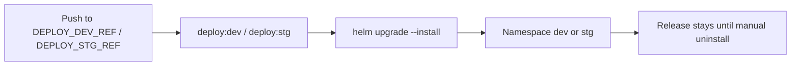
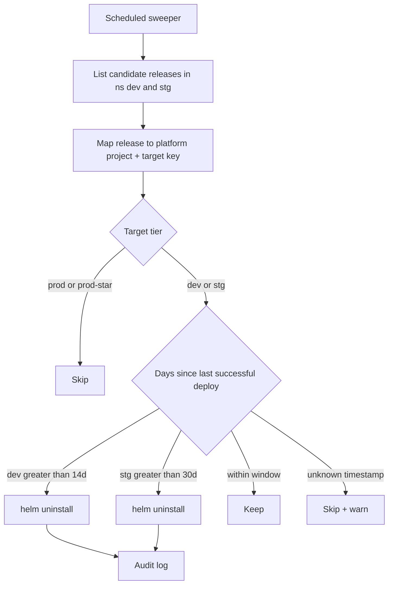

# Milestone — Idle Deployment Retention (dev / stg)

← [Back to Milestone designs](index.md)

> **Status**: Proposed (not yet scheduled)
> **Audience**: Platform maintainers, future-Phase planners
> **Cross-references**: [Deployments](../03_devs/05_deployments.md), [Operations — disk hygiene](../01_infra/04_operations.md), [CI/CD — Auto DevOps deploy](../99_maintainers/06_ci_cd.md), [Env lifecycle cheatsheet](../03_devs/09_env_lifecycle_cheatsheet.md)

Registry tag retention and host image prune reclaim _build_ artifacts, but **Helm releases in `dev` and `stg` namespaces stay forever** after the last successful deploy. On a single-host platform that shares CPU, memory, and disk with GitLab and Sonar, idle app workloads are a silent tax. This milestone defines a scheduled sweeper that **`helm uninstall`s** unused non-production releases after configurable idle windows (defaults: **14 days for dev**, **30 days for stg**). Production is always excluded. The next push to a deploy ref recreates the release via existing `helm upgrade --install`.

---

## Table of contents

1. [Problem & motivation](#1-problem--motivation)
2. [Current state — what's wired up today](#2-current-state--whats-wired-up-today)
3. [Goal & non-goals](#3-goal--non-goals)
4. [Architecture](#4-architecture)
5. [API, schema & config changes](#5-api-schema--config-changes)
6. [Operational considerations](#6-operational-considerations)
7. [Migration & adoption story](#7-migration--adoption-story)
8. [Open questions](#8-open-questions)
9. [Implementation outline](#9-implementation-outline)
10. [Risks & rollback](#10-risks--rollback)
11. [Appendix](#11-appendix)

---

## 1. Problem & motivation

Deployable projects land Helm releases into k3d namespaces (`dev`, `stg`, `prod`) from Auto DevOps. After a spike of demos, spikes, or abandoned feature branches mapped to `develop` / `staging`, those releases continue to:

- Run pods (CPU / memory) even when nobody hits the ingress host.
- Hold PersistentVolumeClaims and image pulls on the shared Docker/k3d layer.
- Multiply operator noise (`kubectl get pods -A`, Traefik routes, failed readiness from bit-rot).

Existing reclaim tools do **not** cover this:

| Mechanism                                 | What it reclaims                 | Idle Helm release? |
| ----------------------------------------- | -------------------------------- | ------------------ |
| `gitlab-registry-retention.sh`            | Old registry _tags_              | No                 |
| `make prune-docker-host --retention-days` | Unused host images               | No                 |
| Mongo / Gitaly failsafe                   | Platform data / host disk policy | No                 |

There is no “last successful deploy older than N days → tear down non-prod” path. Operators either leave junk running or manually `helm uninstall` per project.

---

## 2. Current state — what's wired up today



| Layer                      | Current behaviour                        | Gap                                         |
| -------------------------- | ---------------------------------------- | ------------------------------------------- |
| `.deploy-helm`             | `helm upgrade --install` with `--atomic` | No paired idle uninstall job                |
| GitLab environments        | Created/updated by deploy jobs           | Not used as an idle clock today             |
| Management API             | Provisions targets, hosts, CI vars       | No last-deploy timestamp or sweeper         |
| `pinnedV1` / project flags | Pin exists for v1 migration              | Not used as retention exclude (opportunity) |
| Prod                       | Same Helm path                           | Must never be swept                         |

Deploy path reference: [`configs/auto-devops-pipeline/.gitlab-ci.yml`](../../configs/auto-devops-pipeline/.gitlab-ci.yml) (`.deploy-helm`). Multi-app projects create one release per app target (see [deployment target apps](../03_devs/08_deployment_target_apps.md)).

---

## 3. Goal & non-goals

### 3.1 Goals

1. **Idle clock** — A release in `dev` or `stg` is idle when **no successful deployment** has completed for that environment/release for longer than the retention window.
2. **Default windows** — **dev = 14 days**, **stg = 30 days** (platform env defaults; tunable without code change).
3. **Action = `helm uninstall`** — Remove the Helm release (and its cluster resources) in that namespace only.
4. **Prod excluded** — Never uninstall releases whose deployment target key is `prod` or `prod-*` (or cluster profile prod).
5. **Safe by default** — Dry-run mode; audit every uninstall; skip when last-success timestamp is unknown.
6. **Self-healing redeploy** — Next successful pipeline deploy recreates the release via existing `helm upgrade --install` with no extra schema migration.
7. **Multi-app aware** — For a target with multiple apps, evaluate and uninstall **each** Helm release independently.

### 3.2 Non-goals

- **Not in scope (v1):** Per-project retention overrides in Mongo/GraphQL (platform-wide defaults only).
- **Not in scope:** Scale-to-zero / stop pods while keeping the release (rejected in favour of uninstall).
- **Not in scope:** Deleting GitLab projects, Vault secrets, registry images, or Sonar projects as part of idle retention.
- **Not in scope:** Sweeping `prod` under any flag (no “prod idle” window).
- **Not in scope:** Automatic GitLab environment “stop” API as a hard requirement (nice-to-have if cheap; Helm uninstall is the source of truth for reclaim).

---

## 4. Architecture

### 4.1 High-level design



**Clock source (priority):**

1. **Preferred:** GitLab environment `last_deployment.deployed_at` for the environment name used by the deploy job (e.g. `dev`, `stg`, or per-app environment names).
2. **Fallback:** Management API audit / recorded deploy metadata if introduced alongside the sweeper.
3. **If neither is available:** skip that release and emit a warning (do not guess from Helm revision time alone — chart-only upgrades or failed deploys could mislead). Document Helm `last_deployed` as a **last resort** only if GitLab is unreachable _and_ operators opt in via config (`IDLE_DEPLOY_ALLOW_HELM_TIMESTAMP=true`).

**Action:**

```bash
helm uninstall "${RELEASE_NAME}" --namespace "${KUBE_NAMESPACE}"
```

Do not delete namespaces. Do not touch other projects’ releases. Match release names the same way deploy jobs do (`HELM_RELEASE_NAME` / per-app naming).

**Schedule:** Daily (or every 6–12h) via host Task Scheduler / cron calling either:

- `./bootstrap/idle-deploy-retention.sh` (kubectl/helm against k3d), or
- a Management API maintenance mutation/job that uses the same kubeconfig the API already has for cluster ops.

Prefer API-owned sweep if kube credentials and GitLab token already live there; otherwise a bootstrap script mirrors `gitlab-registry-retention.sh` style.

### 4.2 What changes vs. what stays

| Layer / component      | Before                   | After                                     | Change type |
| ---------------------- | ------------------------ | ----------------------------------------- | ----------- |
| Deploy jobs            | Install/upgrade only     | Unchanged                                 | Unchanged   |
| Prod releases          | Persistent               | Still never swept                         | Unchanged   |
| Sweeper                | None                     | Scheduled dry-run / apply                 | New         |
| `sample.env`           | No idle windows          | `IDLE_DEPLOY_RETENTION_*_DAYS`            | Modified    |
| Audit log              | Provision-focused events | `deploy.idle_uninstalled` (or equivalent) | Modified    |
| Vault / GitLab project | Untouched by idle        | Untouched                                 | Unchanged   |

---

## 5. API, schema & config changes

### 5.1 Platform configuration (`sample.env`)

```bash
# Idle Helm release reclaim (non-prod). Prod is never swept.
IDLE_DEPLOY_RETENTION_ENABLED=false   # default off until operators opt in
IDLE_DEPLOY_RETENTION_DRY_RUN=true    # log candidates only
IDLE_DEPLOY_RETENTION_DEV_DAYS=14
IDLE_DEPLOY_RETENTION_STG_DAYS=30
# IDLE_DEPLOY_ALLOW_HELM_TIMESTAMP=false  # emergency fallback only
```

Windows defaults are placeholders until ops tunes them; changing env vars must not require a code release.

### 5.2 Sweeper contract

Pseudo-interface (API job or script):

```typescript
interface IdleDeployCandidate {
  gitlabPath: string;
  targetKey: "dev" | "stg" | string; // never prod*
  namespace: string;
  releaseName: string;
  lastSuccessfulDeployAt: Date;
  idleDays: number;
  thresholdDays: number;
}

// dryRun=true → log only; dryRun=false → helm uninstall + audit
```

### 5.3 Audit

Each applied uninstall writes an immutable audit row, e.g.:

- `eventType`: `deploy.idle_uninstalled`
- `metadata`: `{ namespace, releaseName, targetKey, lastSuccessfulDeployAt, thresholdDays, dryRun: false }`

### 5.4 Optional GraphQL (if API-owned)

- `idleDeployRetentionPreview`: list candidates (admin).
- `runIdleDeployRetention(dryRun: Boolean!)`: execute once (admin / API key).

Not required if v1 is script-only; document the script as the operator interface then.

### 5.5 Exclusions

Always skip:

- Target key `prod` or matching `^prod(-|$)`
- Releases not mapped to a known platform project (avoid deleting alien Helm releases in shared namespaces — if namespaces are shared, only uninstall releases whose names match platform naming conventions / annotated labels; prefer label `app.kubernetes.io/managed-by=Helm` **and** name match from Mongo `deploymentTargets`)

Recommended v1 soft-exclude: `pinnedV1 === true` projects (treat like “do not auto-reclaim” until operators clear the pin). Document as policy; make configurable later.

---

## 6. Operational considerations

- **Visibility:** Dry-run logs and audit events are the primary signal; optional SMTP later can reuse failsafe mail patterns (out of scope unless cheap).
- **Failed deploys:** Idle clock uses **last successful** deploy only. A streak of failed pipelines does not refresh the clock — intentional (abandoned broken envs still reclaim).
- **Never deployed:** No success timestamp → skip (avoid uninstalling something that was installed out-of-band without GitLab history, or never went green).
- **Multi-app:** Uninstalling one idle app does not remove sibling apps on the same target that are still fresh.
- **Ingress / DNS:** Hostnames in Mongo remain; traffic 404s until redeploy. Developers re-push or re-run the deploy job.
- **Security:** Sweeper credentials need `helm uninstall` in `dev`/`stg` only (RBAC if using a dedicated ServiceAccount). Must not have delete rights that encourage prod mistakes — encode prod skip in code, not only in RBAC.
- **Concurrency:** Use a lock (file or Mongo) so overlapping cron ticks do not double-uninstall.

---

## 7. Migration & adoption story

### 7.1 Backward compatibility

**Default off** (`IDLE_DEPLOY_RETENTION_ENABLED=false`). Existing releases unchanged until operators enable dry-run, review candidates, then set dry-run false.

### 7.2 Opt-in rollout

1. Add env defaults to `sample.env` / document in ops guide.
2. Deploy sweeper in dry-run; capture a week of candidate logs.
3. Enable apply on non-prod.
4. Communicate to developers: idle `dev` (14d) / `stg` (30d) envs disappear; push again to restore.

### 7.3 No project data migration

Mongo projects and Vault paths stay. Only cluster release objects are removed.

---

## 8. Open questions

### Q1 — Sweeper host: API cron vs bootstrap script

**Option A**: Management API scheduled job (GitLab + kube in one place).

**Option B**: `bootstrap/idle-deploy-retention.sh` + host scheduler (like registry retention).

**Recommended**: **A** if API already has reliable kube + GitLab access; else **B** for faster v1. Implementation track should pick one primary; do not ship both as competing sources of truth.

### Q2 — Helm timestamp fallback

**Option A**: Never use Helm `updated` time.

**Option B**: Opt-in via `IDLE_DEPLOY_ALLOW_HELM_TIMESTAMP`.

**Recommended**: **B** disabled by default (matches §4.1).

### Q3 — Per-project overrides

Deferred (non-goal for v1). Revisit if a long-lived staging demo must survive 30d without deploys (manual pin / exclude list).

---

## 9. Implementation outline

### Track A — Clock & candidates

- [ ] Resolve last successful deploy via GitLab environments API for `dev` / `stg` (and per-app env names)
- [ ] Map Helm release names from platform project deployment targets / apps
- [ ] Implement prod / unknown-timestamp / pin exclusions
- [ ] Unit tests for threshold selection (14 vs 30) and prod skip

### Track B — Uninstall & audit

- [ ] `helm uninstall` apply path with dry-run
- [ ] Audit event + structured logs
- [ ] Concurrency lock

### Track C — Scheduling & config

- [ ] `sample.env` + API config keys
- [ ] Cron / Task Scheduler example in ops docs
- [ ] `make idle-deploy-retention` (or API admin mutation) wrapper

### Track D — Documentation

- [ ] Update `__DOCS__/01_infra/04_operations.md` (disk / reclaim section)
- [ ] Note in `__DOCS__/03_devs/05_deployments.md` / env lifecycle cheatsheet
- [ ] Update this milestone: status → Done; freeze decision log

---

## 10. Risks & rollback

| Risk                                 | Likelihood | Impact   | Mitigation                                         | Rollback                                          |
| ------------------------------------ | ---------- | -------- | -------------------------------------------------- | ------------------------------------------------- |
| False idle (GitLab env clock wrong)  | Medium     | Medium   | Prefer last _successful_ deploy; dry-run first     | Redeploy job; disable sweeper                     |
| Uninstall alien release in shared ns | Low        | High     | Name/label allowlist from Mongo only               | Restore from pipeline; tighten matcher            |
| Prod uninstall bug                   | Low        | Critical | Hard-code prod skip + tests; no prod threshold env | Helm history / pipeline redeploy; disable feature |
| Developer surprise                   | Medium     | Low      | Announce windows; docs; default off                | Re-enable dry-run only                            |

**Master rollback strategy:** Set `IDLE_DEPLOY_RETENTION_ENABLED=false` (or stop the cron). Uninstalled apps return on next successful deploy job; no DB restore required.

---

## 11. Appendix

### 11.1 Default windows (locked)

| Target tier       | Idle window | Action           |
| ----------------- | ----------- | ---------------- |
| `dev`             | 14 days     | `helm uninstall` |
| `stg`             | 30 days     | `helm uninstall` |
| `prod` / `prod-*` | —           | Never            |

### 11.2 Decision log

| Question              | Choice               | Date       | Rationale                                           |
| --------------------- | -------------------- | ---------- | --------------------------------------------------- |
| Idle windows          | dev 14d / stg 30d    | 2026-08-14 | Placeholders until ops tunes; env-configurable      |
| Expire action         | Helm uninstall (A)   | 2026-08-14 | Full reclaim; redeploy is already upgrade --install |
| Prod                  | Always excluded      | 2026-08-14 | Safety                                              |
| Per-project overrides | Deferred             | 2026-08-14 | Keep v1 simple                                      |
| Helm timestamp        | Opt-in fallback only | 2026-08-14 | Avoid false positives                               |

### 11.3 Cross-references

- [`configs/auto-devops-pipeline/.gitlab-ci.yml`](../../configs/auto-devops-pipeline/.gitlab-ci.yml) — `.deploy-helm`
- [`__DOCS__/03_devs/08_deployment_target_apps.md`](../03_devs/08_deployment_target_apps.md) — multi-app release names
- [`bootstrap/gitlab-registry-retention.sh`](../../bootstrap/gitlab-registry-retention.sh) — prior art for scheduled reclaim scripts
- [`api/src/projects/projects.service.ts`](../../api/src/projects/projects.service.ts) — project / target model, `pinnedV1`

---

_Authored: 2026-08-14 · Status: Proposed · See [milestone index](index.md) for graduation criteria._
